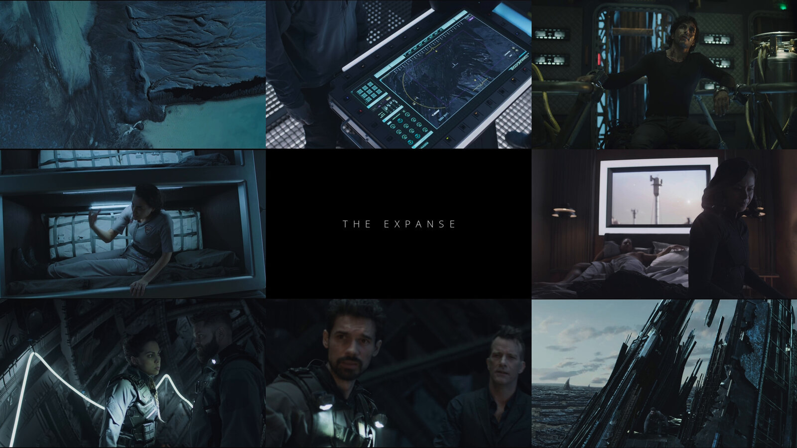
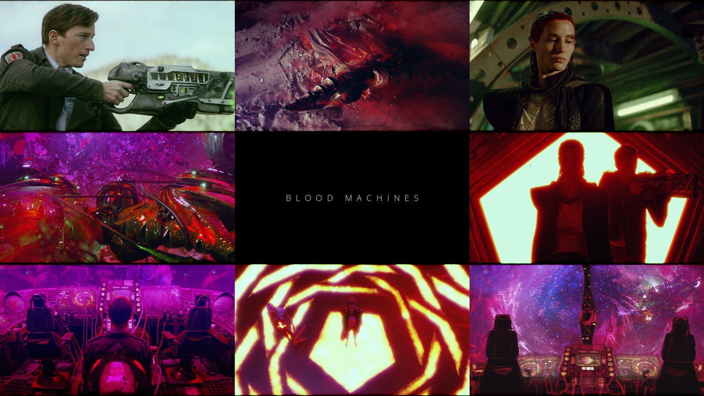
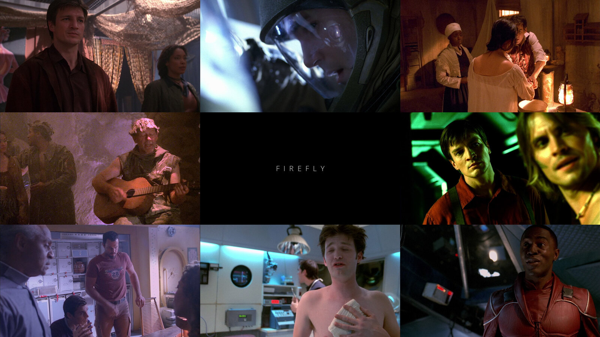
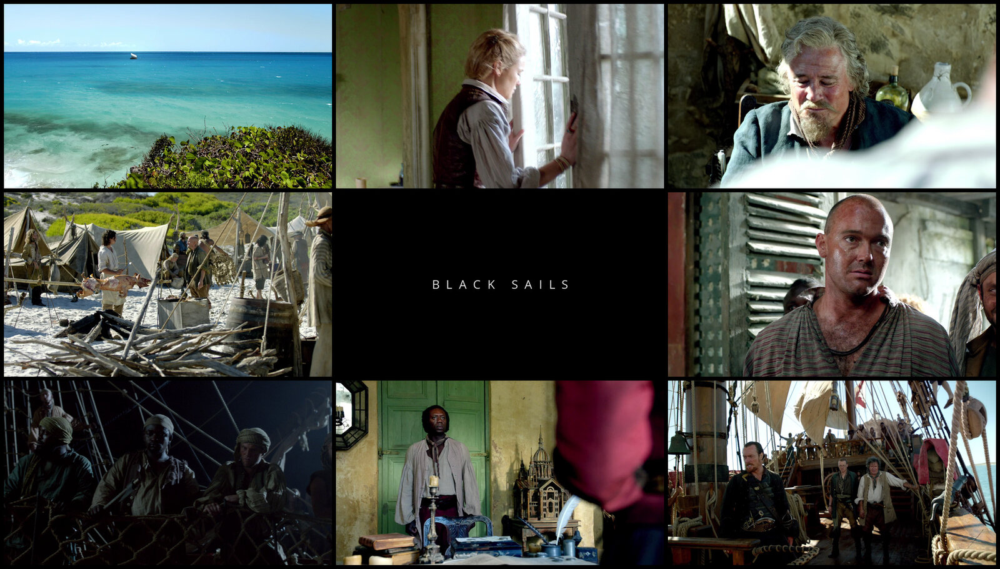
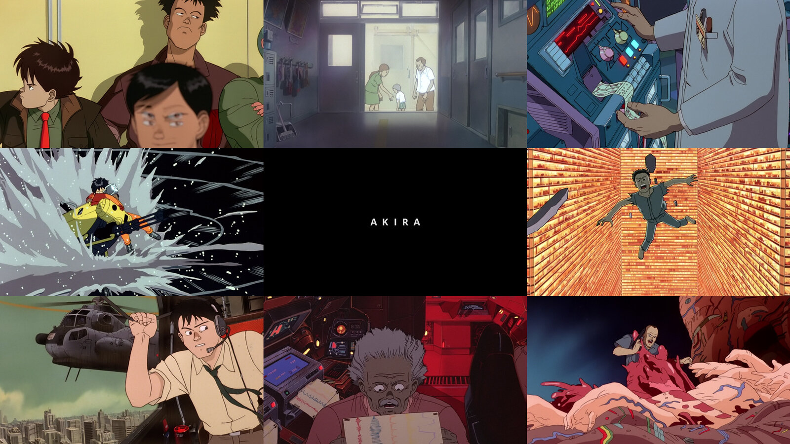
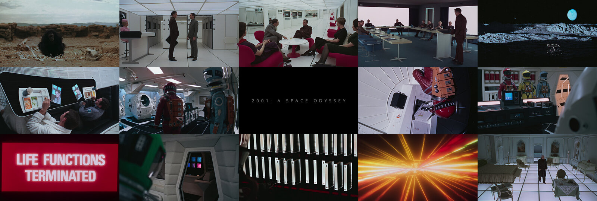
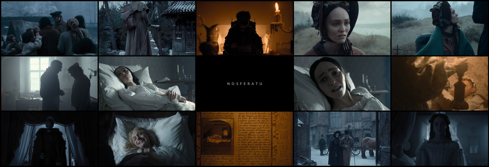
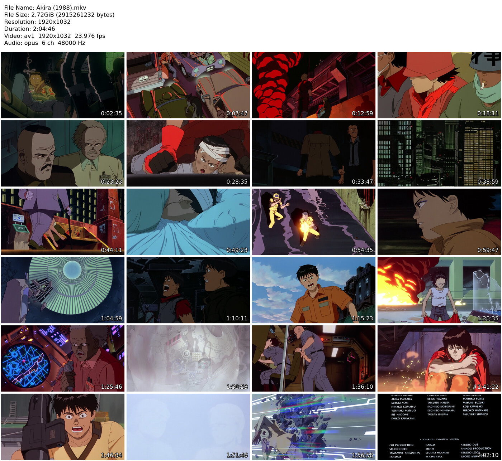

# mpv-collage

Poster-style collages and contact sheets from your own video files, for the terminal and for [mpv](https://mpv.io).

- **`mpv-collage`** makes a gapless grid of frames with the title in the centre tile. Point it at a movie, a season folder or a whole show.
- **`mpv-contact-sheet`** makes an MPC-HC style thumbnail sheet: a header with the file's details above a grid of time-stamped frames.
- **mpv keys:** `Ctrl+Shift+C` makes a collage and `Ctrl+Shift+S` a contact sheet of what is playing. Both show up in the [uosc](https://github.com/tomasklaen/uosc) menu under *Utils*.
- **fish:** a `collage` function, so `cd` into a show and run `collage`.



## Examples

Each collage is one command. Frames come from different episodes for a season or show folder and from across the film for a single file. Everything is done locally with ffmpeg.

| | |
|---|---|
| <br>`mpv-collage <season folder>` with only 3 episodes, so several frames per episode | <br>`--seed 1`, a different set of frames from the same season |
| <br>`--gap 8 --weight regular` | <br>`-t Akira --weight bold` on a single movie file |



`-g 5x3 -w 2400`: a wider grid of a film.



`-g 5x3 --gap 6 --seed 2`.

And the contact sheet (`-n "Akira (1988).mkv"` sets the file name shown in the header):



> The example images contain frames from films and TV shows, shown only to demonstrate the tool. They belong to their respective owners.

## Install

```sh
git clone https://github.com/Demitrix2k/mpv-collage
cd mpv-collage
./install.sh --bind      # --dry-run first to see what it would do
```

It puts `mpv-collage` and `mpv-contact-sheet` in `~/.local/bin`, the two Lua scripts in your mpv `scripts/` folder and, if fish is installed, the `collage` function in `~/.config/fish/conf.d/`. `--bind` also adds the two keys to `input.conf`; without it the installer prints the lines for you to paste. `./install.sh --uninstall` removes everything again.

Needs `ffmpeg`/`ffprobe`, Python 3 with [Pillow](https://python-pillow.org) (`mpv-collage`) and ImageMagick (`mpv-contact-sheet`). On Arch: `pacman -S ffmpeg python-pillow imagemagick`.

## Use

### In mpv

`Ctrl+Shift+C` makes a collage. If the folder of the playing file holds several videos (a season), the collage uses the whole folder, otherwise just that file. `Ctrl+Shift+S` makes a contact sheet of the playing file. Local files only. Results go to `~/Pictures/mpv/`, and the path is shown on screen.

### In fish

```fish
cd ~/Videos/The.Expanse/Season\ 4
collage                      # the current folder
collage --seed 3 -g 5x3      # options go straight through
collage ~/Videos/Movie.mkv   # or give a path
```

### On the command line

```sh
mpv-collage PATH [-t TITLE] [--no-title] [-g CxR] [-w WIDTH] [--gap PX]
                 [--seed N] [--weight thin|regular|bold] [-o OUTPUT]
mpv-contact-sheet [-c COLUMNS] [-r ROWS] [-w WIDTH] [-o OUTPUT] [-n NAME] FILE
```

| Option | Does |
|---|---|
| `-t` | Title for the centre tile. The default is guessed from the folder or file name, skipping `Season 4`, release tags and years. |
| `--no-title` | Frames only. |
| `-g CxR` | Grid size, default `3x3`. The title tile needs both numbers odd (`3x3`, `5x3`), otherwise there is no title. |
| `-w` | Output width in pixels, default 2000. |
| `--gap` | Pixels of black between tiles, default 0. |
| `--seed` | Different frames. The same seed gives the same collage; the default is seed 0, and other seeds are saved as `<title>-collage-seed<N>.jpg`. |
| `--weight` | Title font weight. |
| `-o` | Output file. |

## How it picks frames

- Frames are drawn evenly across the file, or across the episodes, and stay clear of the first and last 8 % to skip intros and credits.
- For each tile it tries 6 nearby frames and keeps the sharpest, best-exposed one, so black, flat and motion-blurred frames are rare.
- Black letterbox bars are trimmed per frame (flat, near-black rows at the top and bottom), and every frame is cropped to fill a 16:9 tile.
- HDR files (PQ or HLG) are tone-mapped to SDR with ffmpeg's `zscale` and `tonemap`, so they do not look washed out.
- Folders called `Subs`, `Extras`, `Featurettes`, `Samples`, `Trailers`, `Specials` or `Season 0`, and files shorter than 5 minutes (when there are others), are skipped.

A 3x3 collage takes about 20 to 40 seconds, longer for 4K HDR.

## Notes

- The title font is Open Sans (light, regular or bold), looked up with `fc-match`; if it is missing you get whatever fontconfig picks instead.
- Dark shows give dark collages: the sharpness check favours detailed frames. Try another `--seed`.

## License

MIT, see [LICENSE](LICENSE).
